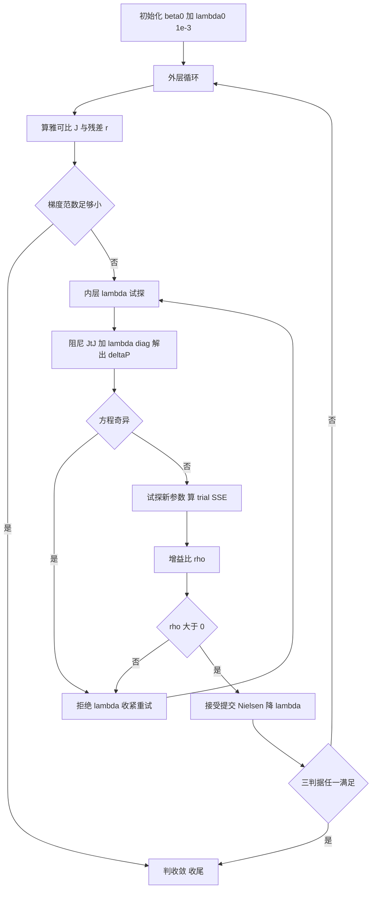

# LM（Levenberg-Marquardt）算法详解

> 非线性最小二乘的事实标准算法。目标：给定模型 f(x; β) 与数据 (xᵢ, yᵢ)，找参数 β 使残差平方和最小。LM = Gauss-Newton 的速度 + 最速下降的稳妥，用一个阻尼因子 λ 在两者之间自适应切换。

---

## 一、要解决什么问题？

拟合的目标是最小化残差平方和：

```
S(β) = Σᵢ [yᵢ − f(xᵢ; β)]²
```

**线性模型有闭式解**（见 `linear-least-squares.md`）：S 对 β 求导后是线性方程，一步解出。

**非线性模型没有闭式解**：如指数模型 c(t) = c₀·e^(−kt)，S 对 k 求导后 k 同时出现在指数和分母里，无法解析求解。只能**迭代**——从初值 β₀ 出发，一步步走向更优的 β。

迭代的核心问题只有一个：**每一步往哪个方向走、走多远？**

---

## 二、两条经典路线及其短板

### 2.1 最速下降（梯度下降）

沿负梯度方向走：Δp ∝ −∇S。

- ✅ 稳：只要步长够小，S 必然下降
- ❌ 慢：在狭长的"香蕉谷"状误差面上反复震荡（物化拟合参数常跨尺度，如 A ~ 10⁴ 与 k ~ 10⁻⁶ 同拟，误差面正是这种形态）

### 2.2 Gauss-Newton

把模型在当前点线性化（一阶泰勒展开），直接解线性化的正规方程：

```
(JᵀJ) · Δp = Jᵀr        其中 J 是雅可比，r 是残差
```

- ✅ 快：在极值点附近二阶收敛，几步就到
- ❌ 脆：离极值点远时可能发散；JᵀJ 接近奇异时步长爆炸

### 2.3 对比

| 维度 | 最速下降 | Gauss-Newton | LM |
|---|---|---|---|
| 方向 | 负梯度 | 线性化正规方程 | 两者插值 |
| 远离极值点 | 稳但慢 | 可能发散 | 稳（偏梯度行为） |
| 靠近极值点 | 震荡慢收敛 | 二阶收敛快 | 快（偏 GN 行为） |
| 步长控制 | 学习率手工调 | 无 | λ 自动调 |

---

## 三、LM 的核心思想：一个 λ 调和两端

LM 每次迭代解的是**阻尼正规方程**：

```
(JᵀJ + λ·diag(JᵀJ)) · Δp = Jᵀr
```

对角阻尼项 λ·diag(JᵀJ)（Marquardt 建议，兼顾参数尺度归一）的作用：

| λ | 方程行为 | 等价于 |
|---|---|---|
| λ → ∞ | Δp ≈ (1/λ)·Jᵀr，小步沿梯度方向 | 最速下降 |
| λ → 0 | Δp = (JᵀJ)⁻¹Jᵀr | Gauss-Newton |
| 中间 | 两者之间连续插值 | LM |

**直觉**：λ 是"每步敢走多远"的旋钮。当前线性化近似得好 → 调小 λ 放胆走（GN）；近似得差 → 调大 λ 保守小步走（梯度）。

---

## 四、怎么判断"近似得好不好"？——增益比 ρ

每解出一部 Δp，先**试探**：算一下如果真的走这一步，SSE 实际能降多少。与"线性化预测能降多少"相比：

```
ρ = 实际 SSE 下降量 / 预测 SSE 下降量
```

ρ 的语义：

| ρ 范围 | 含义 | 决策 |
|---|---|---|
| ρ ≈ 1 | 线性化预测很准，该区域模型近线性 | 接受，λ 调小（放胆） |
| 0 < ρ < 1 | 有下降但不如预测 | 接受，λ 略调 |
| ρ ≤ 0 | 实际不降反升，线性化完全失真 | 拒绝这一步，λ 调大（收紧）后重试 |

这就是**信赖域（trust region）思想**：线性化只在当前点附近一个小区域内可信；ρ 就是"可信度评分"，λ 间接控制这个区域的半径。

> 本实现中 ρ ≤ 0 一律拒绝（比早期 LM 的"ρ > 0 才接受"更严：即使 SSE 碰巧下降、但预测已失真的步也拒收），预测下降量用二阶截断公式 predRed = 2Δᵀg − ΔᵀAΔ。

---

## 五、λ 怎么升降？——Nielsen 1999 策略（本项目默认）

λ 的更新规则直接影响收敛速度。本项目采用 Nielsen 方案（MINPACK 系现代实现的事实标准）：

| 步型 | 更新规则 | 直觉 |
|---|---|---|
| 接受（ρ > 0） | λ ×= max(1/3, 1 − (2ρ−1)³) | ρ→1 时因子→0，λ 大幅缩小放胆；ρ 刚过 0 时因子→2，λ 反而增大（勉强接受也要收紧）；下限 1/3 托底防一步放太开 |
| 拒绝（ρ ≤ 0） | λ ×= v，然后 v ×= 2 | 连续失败时 λ 指数式收紧；一旦成功，v 复位 2 |

护栏：λ ∈ [1e-12, 1e12]——过小退化为纯 GN（可能步长爆炸），过大退化为纯梯度（停滞）。初始 λ₀ = 1e-3。

对照方案：classic 三段式（ρ 分段后乘固定倍数），保留作交叉验证（`verify-trust-region.ts` 验证双策略收敛到同一结果）。

---

## 六、迭代全流程



内层试探最多 maxInnerIterations = 20 次，外层最多 maxIterations = 100 次。

---

## 七、收敛判据（三判据 OR）

任一满足即停止：

1. **参数判据**：每个自由参数的相对变化最大值 < paramTolerance（默认 1e-8）
2. **损失判据**：SSE 绝对值足够小，或相对首次 SSE 下降到 costTolerance 倍（默认 1e-8）——相对形式兜底加权场景（σ = 0.01 时 SSE 量级被 1/σ² 放大，绝对判据永不触发）
3. **梯度判据**：‖JᵀWr‖∞ < gradientTolerance（默认 1e-8）

另有**梯度预检查**：外层每轮开始先查梯度范数，初值恰好已在极值点附近时直接判收敛，避免"trial SSE ≈ current SSE 永远拒绝"的死循环。

---

## 八、统计输出（教学口径）

收敛后在**最终参数处重算雅可比**，拼装：

| 量 | 公式 | 含义 |
|---|---|---|
| 协方差 | σ²·(JᵀWJ)⁻¹，σ² = SSE/dof | 参数估计的方差-协方差 |
| 参数标准误 | √diag(协方差) | 每个参数的不确定度 |
| dof | n − p（自由参数数） | 自由度 |
| R² / RMSE | 常规定义 | 拟合优度 |

这些公式的线性化前提：残差接近线性、模型正确、σ 估计正确。教学场景提醒学生：标准误是"线性化近似下的不确定度"，不是精确置信区间。

---

## 九、使用示例（对象式传参）

```typescript
import { levenbergMarquardt, singleXToMatrix } from "@shared/fitting/index.ts"

// 模型：y = A·exp(−k·t) + C（一级反应 + 终值偏移）
const result = levenbergMarquardt({
  fn: (xData, p) => {
    // xData 是 n×1 设计矩阵（行主序扁平存储），返回 Float64Array
    const ys = new Float64Array(xData.rows)
    for (let i = 0; i < xData.rows; i++) {
      ys[i] = p.A * Math.exp(-p.k * xData.data[i]!) + p.C
    }
    return ys
  },
  initialParams: { A: 2, k: 0.5, C: 0.3 },  // 全参数初值（含固定参数）
  paramNames: ["A", "k"],                    // 自由参数子集（C 固定时的写法）
  xData: singleXToMatrix(tData),             // 单自变量标量数组 → n×1 设计矩阵
  yData: cData,
  options: { sigmaY: cSigma },               // 可选；weights = 1/σ² 自动转换
})

result.params        // 全参数字典
result.paramErrors   // 自由参数标准误
result.isConverged
result.finalLambda   // LM 独有诊断：最终阻尼因子
```

接口要点：

- **对象式传参**：五字段 + options，防位置错位
- **参数两分**：initialParams 全字典 + paramNames 自由子集；固定参数不参与更新但透传给 fn
- **依赖注入**：options 可替换雅可比 / 求解器 / 阻尼策略，默认实现开箱即用

---

## 十、与 LLS / ODR 的关系

| | LLS | LM | ODR |
|---|---|---|---|
| 模型 | 线性 | 非线性 | 非线性 |
| x 误差 | 忽略 | 忽略 | 显式建模（σx） |
| 解法 | 闭式一步 | 迭代 | 迭代（Schur 补降维的 LM 推广） |
| 关系 | LM 的线性特例（λ → 收敛一步到位） | ODR 在 σx = 0 时的退化形态 | LM 的推广 |

σx 可忽略的 (t, c) 动力学数据用 LM 足够；x 误差与 y 误差量级相当时（如校准曲线）改用 ODR。

---

## 十一、参考文献

1. **Marquardt, D. W. (1963)** — "An Algorithm for Least-Squares Estimation of Nonlinear Parameters". *J. Soc. Ind. Appl. Math.* 11(2), 431-441. —— LM 原始论文（对角阻尼归一）
2. **Levenberg, K. (1944)** — "A Method for the Solution of Certain Non-Linear Problems in Least Squares". *Quart. Appl. Math.* 2, 164-168. —— 阻尼思想起源
3. **Nielsen, H. B. (1999)** — "Damping Parameter in Marquardt's Method". Technical Report IMM-REP-1999-05, DTU. —— 本项目默认的 λ 自适应策略
4. **Moré, J. J. (1978)** — "The Levenberg-Marquardt Algorithm: Implementation and Theory". *Numerical Analysis*, Springer. —— MINPACK 系实现的理论基础
5. **Nocedal & Wright** — *Numerical Optimization*, 2nd ed., Springer, 2006. Chapter 10（信赖域方法）
